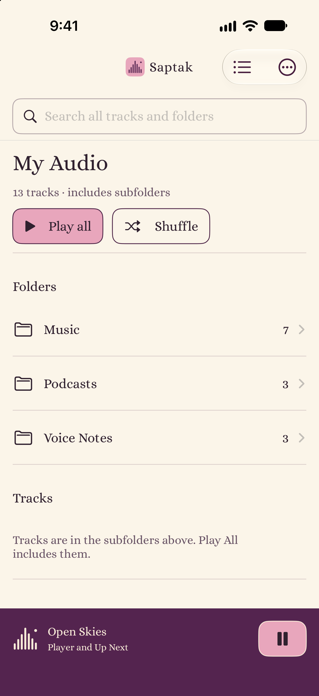
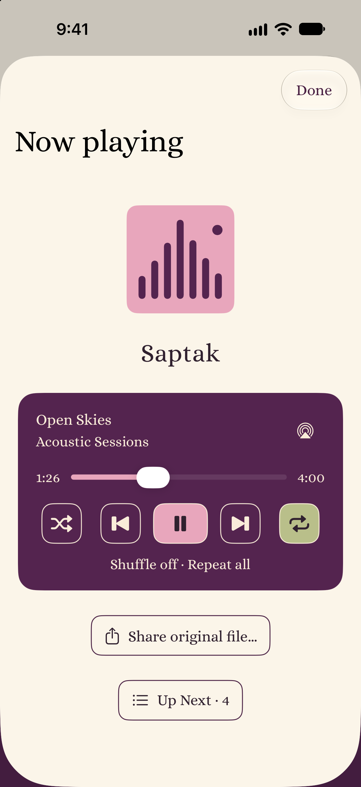
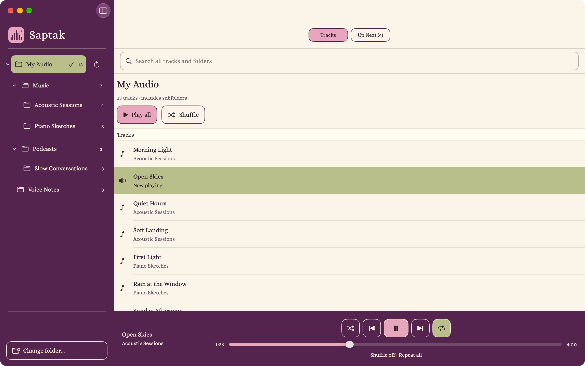

# Saptak

**Your audio. Yours to play.**

Saptak is an open-source audio player for iPhone, iPad and Mac. Play music, voice notes, lessons and other recordings directly from folders you choose. Every folder becomes a playlist, including its subfolders.

Your original files stay where you keep them. No accounts, analytics, subscriptions, backend services or permanent audio imports.

[Website](https://gogrinimish.github.io/Saptak/) · [Support](https://gogrinimish.github.io/Saptak/support.html) · [Privacy](https://gogrinimish.github.io/Saptak/privacy.html)

## Screenshots

Actual app screens with fictional sample audio.

<p>
  
  
</p>



## Features

- Browse nested folders with parent breadcrumbs on iPhone. Refresh manually or automatically when returning to the app (throttled).
- Play a folder and its subfolders, or start a playlist at a selected track.
- Use shuffle, repeat, Up Next, playback controls and seeking.
- Search track and folder names across your library, with folder paths to distinguish matches.
- Share original audio files through the system share interface (track context menus and the iPhone player).
- Control playback through the system's Now Playing controls and media keys.
- Read embedded title, artist, album and artwork on playback, with filename fallbacks; browsing does not fetch cloud audio for tags.
- Access folders through native Apple document providers, including iCloud Drive. Other locations depend on the provider’s folder-access support.
- Find cloud-folder setup and download guidance from the welcome screen or folder actions.
- Use the iPhone AirPlay picker or Mac system audio routing.

Saptak is in development. Basic Mac playback/persistence/system controls and physical iOS system controls/AirPlay-to-Mac have manual acceptance; mobile UI, broader providers and the full accessibility/codec matrix remain under validation. AirPlay receiver compatibility requires hardware testing. No TestFlight or App Store availability is implied by this repository.

Provider downloads may use device storage. The active queue is a snapshot; refreshing updates the browser, and starting playback again uses the refreshed folder contents.

## Requirements and development

- iOS 16+ or macOS 13+.
- Xcode with the platform SDKs, Swift 5.9-compatible language mode, Python 3 and XcodeGen.
- No third-party app runtime dependencies.

```sh
xcodegen generate
open Saptak.xcodeproj
```

Select **SaptakMac → My Mac**, or **Saptak-iOS → an iPhone/iPad simulator**. The visible app name is Saptak on both platforms; both use `com.playsaptak.app`. Device/distribution signing uses your Apple Developer team and is not committed.

```sh
scripts/validate.sh
```

Validation runs tests, generates the project, builds a locally signed Mac app and an unsigned iOS Simulator app. Builds alone do not establish device behavior. See [testing](docs/TESTING.md) for individual commands and environment limitations.

## Project

- `Sources/SaptakCore`: portable folder scanning and queue logic.
- `App`: native file access, AVPlayer, system media controls and SwiftUI.
- `Tests`: synthetic fixtures and regression tests.
- `project.yml`: generated Xcode project configuration.
- `Design`: editable icon source; installed icon renditions live in the asset catalog.
- `site`: product website, privacy page and reviewed sample screenshots; see [website publishing](docs/WEBSITE.md).

See [contributing](CONTRIBUTING.md), [architecture](docs/ARCHITECTURE.md), [roadmap](docs/ROADMAP.md), [privacy](docs/PRIVACY.md) and [release instructions](docs/RELEASING.md).

Supported filename extensions include M4A, MP3, AAC, WAV, AIF/AIFF, CAF, FLAC and OPUS. Actual playback depends on codec, container and OS version; no third-party decoder is bundled. Direct Google Drive integration, Chromecast and explicit offline storage are future work.

Saptak (सप्तक) refers to a musical octave. App source is licensed under [MIT](LICENSE). The bundled Alice font is separately licensed under the [SIL Open Font License](App/Fonts/OFL.txt).

Playback recovery remembers the last queue and position locally and restores paused when the selected folder is available. Missing tracks are omitted; the current track must still exist. iOS interruptions resume only with system permission and no intervening pause; output disconnection pauses playback. Device and provider edge cases remain under validation.

## Support Saptak

If Saptak makes room for your audio, you can support its development with an optional coffee.

<a href="https://www.buymeacoffee.com/HWRxT65O5I"></a>
